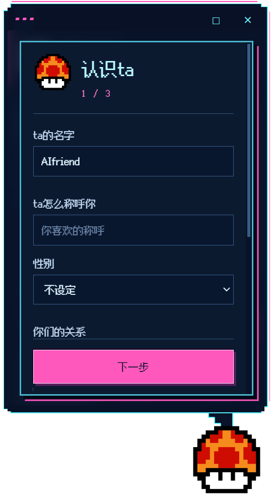
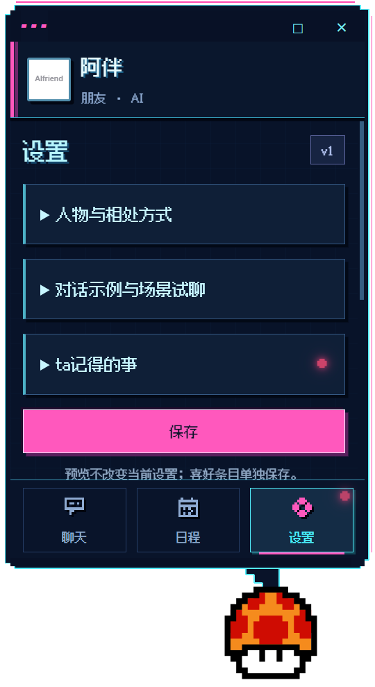

# AIfriend

Windows AI 桌宠 · 0.9.17

拖动桌面上的像素蘑菇，单击打开聊天、日程和设置。第一次打开设置自己的角色，无需注册账号或填写 API 密钥。

当前为 0.9.17 预发布版，下载安装见[版本发布页](https://github.com/llluoyanting/AIfriend/releases)。云端额度保护已开启，采用已确认的体验方案：总模型预算20元/天、每设备300轮/天。其他电脑的安装验收将在下载安装后进行。

## 可以做什么

- 自定义人物、称呼、说话方式和方言。
- 通过聊天或日历创建、修改、取消单次提醒；缺少信息时继续补充。
- 设置主动消息话题、频率和免打扰，查看联网消息的来源。
- 整理近期聊天中的喜好与习惯，确认后保存为可管理的长期记忆。
- 在本机保留聊天、人设、日程和头像；支持初始化重新开始。

## 安装

发布后从本仓库 Releases 下载 `AIfriend-Setup-0.9.17-windows-x64.exe`，运行安装并完成首次设置。安装包约 146 MiB，仅面向 Windows x64；当前未进行代码签名。

AI 回复与联网查询需要网络及体验服务。收起气泡后程序仍运行；彻底退出请使用托盘菜单。退出或关机后不会在云端继续执行本机提醒。

## 界面

以下为独立测试档案的界面，不包含真实使用者数据。

## 说明

- [使用说明](docs/使用说明.md)
- [隐私与数据](docs/隐私与数据.md)
- [演示步骤](docs/演示步骤.md)
- [验证摘要](docs/验证摘要.md)
- [重点版本变化](CHANGELOG.md)

本项目为个人作品和小范围体验，模型结果仍可能出错。重要日程请核对日历中的实际记录。安装文件附带的第三方许可说明见 `licenses/`；本说明不额外授予项目素材的再分发权限。
